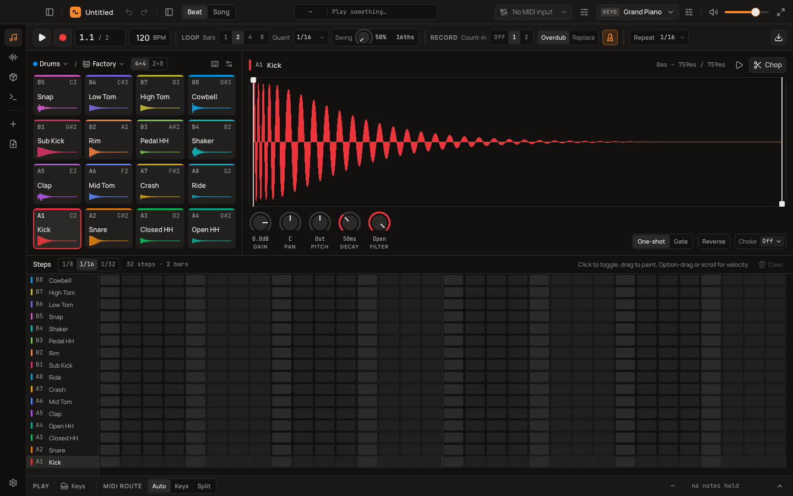
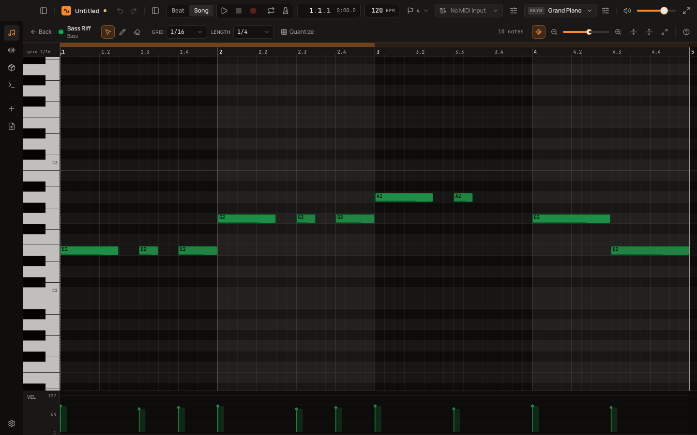
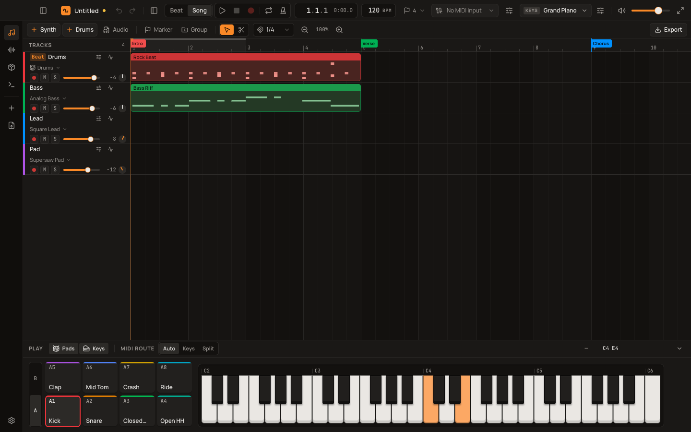
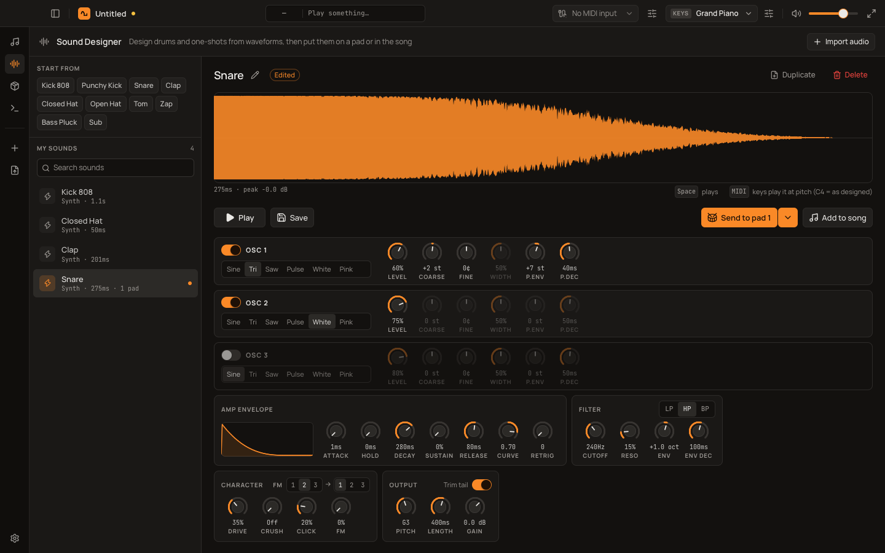

<p align="center">
  
</p>

<h1 align="center">Micro DAW</h1>

<p align="center">
  A focused desktop beat maker for MIDI pad controllers (built around the AKAI MPK Mini Play).
</p>

<p align="center">
  
  
    
</p>

<p align="center">
  
</p>

## Features

### Beat view (home screen)

Plug in a pad controller, load samples onto pads, finger-drum over a loop, then fix it in the step grid.
A fresh project opens here with a "Drums" track on the built-in factory kit, a 2-bar loop,
1/16 quantize and the recording metronome on, so you can play straight away.

- 16 pads (bank A/B, 4×4 or 2×8 layout) played from the controller, the mouse or the computer keys
  `Z X C V / A S D F / Q W E T / 1 2 3 4`
- Drag samples from the sample browser (or Finder) onto pads; chop a sample to pads by transients or equal slices
- Per-pad editor: trim, gain, pan, pitch, one-shot/gate, reverse, choke groups, plus sound shaping per pad:
  AHDSR amp envelope (draggable curve), LP/HP/BP filter with resonance and its own envelope, pitch envelope and drive
- Loop recording with count-in, quantize (with swing) and overdub/replace
- Note repeat (`N`, rate 1/4 to 1/32): hold a pad to retrigger it on the grid while the transport runs; repeats are recorded too
- Step sequencer (1/8, 1/16, 1/32) with per-step velocity
- Kits per drum track; save and load your own kits
- Controller setup: learn the pad notes and map knobs to pad pitch/decay/filter/gain, swing, tempo and volumes

### Sample browser

A file browser for your sample folders, docked on the left in both views (`B` toggles it).
Click to audition, arrow keys move and preview, `Enter` loads the file onto the selected pad.

### Packs

The Packs page (sidebar, `Ctrl+3`, or "Browse packs…" in the Beat view's kit menu) puts ready-made
16-pad kits one click away. "Load on pads" replaces the current drum track's kit and opens the Beat view.

- **Built-in kits** - six synthesized machines: 808-, 909-, 707-, 606-, LinnDrum- and CR-78-style.
  Every voice is generated in the app (`rune/crates/mdaw-dsp/src/classic/`), so they work offline and have no
  licensing strings attached. They are original syntheses in the style of those machines, not samples
  of them, and are not affiliated with or endorsed by the makers.
- **Downloadable packs** - free recordings from a curated catalog (`packs/catalog.json`, also fetched
  from GitHub so new packs appear without an app update). Each pack downloads once into
  `<userData>/packs/<id>`, shows up in the sample browser under "Installed packs", and adds its kits to
  the kit menu. Sounds can be auditioned before downloading. Downloads are restricted to GitHub hosts
  over https, size-capped and checked against the sha256 in the catalog.

Included packs (all CC0 or public domain; every pack ships the upstream licence/readme):

| Pack | By | Licence |
|------|----|---------|
| TR-808 Recordings | Michael Fischer / Technopolis (1994), via [tidalcycles/sounds-tr808-fischer](https://github.com/tidalcycles/sounds-tr808-fischer) | CC0 1.0 |
| 909 · 707 · 606 · 727 (TR-8 Recordings) | MckAudio, [MckAudio/MckSamplePacks](https://github.com/MckAudio/MckSamplePacks) | CC0 1.0 |
| uzu Drumkit | Mot4i, Switch Angel and Ludens (TidalCycles community), [tidalcycles/uzu-drumkit](https://github.com/tidalcycles/uzu-drumkit) | Public domain (Unlicense) |
| Sonic Pi Drums & Percussion | Sonic Pi sample library (freesound contributors), [sonic-pi-net/sonic-pi](https://github.com/sonic-pi-net/sonic-pi) | CC0 1.0 |
| FreePats Synth Percussion | Roberto (FreePats project), [freepats/synthesizer-percussion](https://github.com/freepats/synthesizer-percussion) | CC0 1.0 |

Licence evidence, rejected candidates and how to add a pack are in [docs/packs.md](docs/packs.md)
(`node scripts/pack-check.mjs --online` validates the catalog and checks every URL).

### Song view (arrangement)

Arrange patterns and other tracks into a song (`Tab` switches Beat / Song).

- Multi-track timeline with drag-and-drop regions
- Built-in synth presets and drum kits
- Piano roll editor with draw, select, and erase tools
- Velocity editing per note
- Loop and punch recording
- Timeline markers for navigation
- Track groups with collapse/expand
- Mixer with per-track volume, pan, mute, and solo
- Effects panel (reverb, delay, etc.)
- Undo/redo (up to 50 snapshots)

<p align="center">
  
</p>

### MIDI Support

Connect any USB MIDI controller and play in real-time.

- Auto-detect MIDI devices
- Zero-latency software instrument playback
- Pads and knobs mapped through a controller profile (default: MPK Mini, pads on notes 36–51, knobs on CC 70–77)
- The keys play the live synth (pick a preset in the top bar)
- "Keyboard" mode to use your controller's built-in sounds while still recording MIDI
- Record MIDI input directly into the arrangement

<p align="center">
  
</p>

### Sound Designer

Design your own drums and one-shots from waveforms (`Ctrl+2`), keep them editable, and use them straight away.

- Start from a template (808 and punchy kicks, snare, clap, hats, tom, zap, bass pluck, sub) or from scratch
- 3 oscillator layers (sine, triangle, saw, pulse with width, white/pink noise), each with level, tuning and its own pitch envelope; FM between layers
- AHDSR amp envelope, LP/HP/BP filter with envelope, drive, bit-crush, click layer, length with tail auto-trim
- Every change re-renders live; Space, the arrow keys and your MIDI keys audition the sound
- Sounds are saved as recipes (in the project and in your library), so every knob stays editable; editing a sound updates the pads that use it
- **Send to pad** and **Add to song** put a sound to work in one click
- Imported audio (button or drag-and-drop) gets one simple edit panel: trim, fades, gain, normalize, reverse (the file on disk is never changed)

<p align="center">
  
</p>

### Export

Export your work as audio or MIDI files.

- WAV export (offline render)
- MIDI export (with GM-standard drum mapping on channel 10)
- Respects muted tracks

### Other

- **Project templates** - Start from blank, rock, hip-hop, jazz, EDM, or ambient presets
- **Command palette** - Quick access to all actions (`Cmd+K`)
- **MIDI developer monitor** - Raw MIDI message inspector
- **Update check** - Checks GitHub Releases and opens the release page
- **Keyboard shortcuts** for everything

## Keyboard Shortcuts

| Shortcut | Action |
|----------|--------|
| `Space` | Play / Stop (the Beat view loops the pattern) |
| `R` | Beat view: record loop · Song view: record to the armed track |
| `M` | Toggle metronome |
| `N` | Toggle note repeat |
| `B` | Toggle sample browser |
| `Tab` | Switch Beat / Song view |
| `Shift+Backspace` | Clear pattern (Beat view) |
| `Z X C V / A S D F / Q W E T / 1 2 3 4` | Play pads 1–16 (Beat view) |
| `L` | Toggle loop (Song view) |
| `Ctrl+Z` / `Ctrl+Y` | Undo / Redo |
| `Ctrl+E` | Export dialog |
| `Ctrl+K` | Command palette |
| `Ctrl+1-4` | Switch modes (DAW, Sound Designer, Packs, Dev) |
| `Shift+M` | Add marker |
| `[` / `]` | Previous / Next marker |
| `Ctrl+G` | Create track group |
| `Cmd+,` | Settings |
| `Escape` | Close piano roll editor |

## Tech Stack

The app is native Rust (it was ported from an Electron/React/Tone.js app; the port is documented in
[docs/rune-port-plan.md](docs/rune-port-plan.md) and [docs/rune-parity.md](docs/rune-parity.md)).

| Layer | Technology |
|-------|------------|
| UI | [Rune](https://github.com/anomalyco/rune) (wgpu/winit, declarative views, AccessKit accessibility) |
| Audio I/O | [cpal](https://github.com/RustAudio/cpal) |
| MIDI | [midir](https://github.com/Boddlnagg/midir) |
| DSP / engine | Own crates: allocation-free realtime engine, offline render shares the same code |
| Tests | `cargo test` (unit, golden-parity fixtures, offline-render regressions, headless UI runtime tests) |

## Getting Started

### Prerequisites

- [Rust](https://rustup.rs/) (the toolchain is pinned in `rune/rust-toolchain.toml`)
- macOS (the primary target; Windows and Linux are untested)

### Run

```bash
git clone https://github.com/yemirhan/micro-daw.git
cd micro-daw/rune
cargo run -p mdaw-app --release
```

### Build the macOS app

```bash
rune/scripts/build-mac-app.sh            # -> rune/dist/Micro DAW.app (ad-hoc signed)
MAC_APP_SIGN="Developer ID Application: …" rune/scripts/build-mac-app.sh   # real identity + hardened runtime
```

Notarizing is a manual step, see [docs/rune-port/phase-10-app-shell.md](docs/rune-port/phase-10-app-shell.md).

### Checks

```bash
cd rune
cargo fmt --check
cargo clippy --workspace --all-targets -- -D warnings
cargo test --workspace
```

`MDAW_AUDIO=null` runs the app without opening an audio device. `micro-daw --snap out.png --scene <name>`
renders a UI scene headlessly (see `rune/crates/mdaw-app/src/scenes*.rs`).

The golden fixtures in `rune/parity/fixtures/` were generated from the original Electron app's code
and are kept as frozen regression references.

## Project Structure

```
rune/crates/
├── mdaw-model/       # Project/arrangement model, undo, migrations, kits, settings, sound recipes
├── mdaw-dsp/         # DSP building blocks: synth voices, filters, classic kits, pad shaping, sound design, decoding
├── mdaw-engine/      # Realtime engine: transport, scheduling, instruments, sampler, mixer/FX, export
├── mdaw-audio-host/  # Audio device I/O (cpal)
├── mdaw-midi/        # MIDI input/output and routing (midir)
├── mdaw-packs/       # Pack catalog, downloads, installer
└── mdaw-app/         # The app: views, actions, services, project files, tests
packs/                # Pack catalog (generated) + curated sources (packs/sources/*.json)
scripts/              # pack-build / pack-check (Node, no dependencies)
docs/                 # Plans, port phase docs, reviews, screenshots
```

## Architecture

- The **engine** runs on the audio thread without allocations or locks; the UI builds patches and schedules on the control side and hands them over through lock-free queues (garbage goes back through a ring for freeing off the audio thread).
- Offline export and live playback share the same render code.
- Drum tracks play a **sampler kit** (16 pads per track, per-pad shaping). Live pad hits go through the active drum track (so its FX apply) and into the loop recorder; note repeat retriggers held pads on the transport grid; controller knobs map to parameters.
- Edits during playback reschedule only the changed tracks; removed notes and regions are cut or faded precisely.
- The **UI** is a Rune view function over the app state; undo/redo works on document snapshots.

## Credits

- Drum packs: see [Packs](#packs) and [docs/packs.md](docs/packs.md) for each pack's author, source and licence. Thanks to Michael Fischer, MckAudio, the TidalCycles and Sonic Pi communities and the FreePats project for releasing their recordings freely.
- Piano samples: [Salamander Grand Piano V3](https://archive.org/details/SalamanderGrandPianoV3) by Alexander Holm, licensed [CC-BY 3.0](https://creativecommons.org/licenses/by/3.0/) (reduced MP3 set as redistributed with Tone.js), bundled in `rune/crates/mdaw-engine/assets/piano/`.

## License

[MIT](LICENSE) - Yusuf Emirhan Sahin
