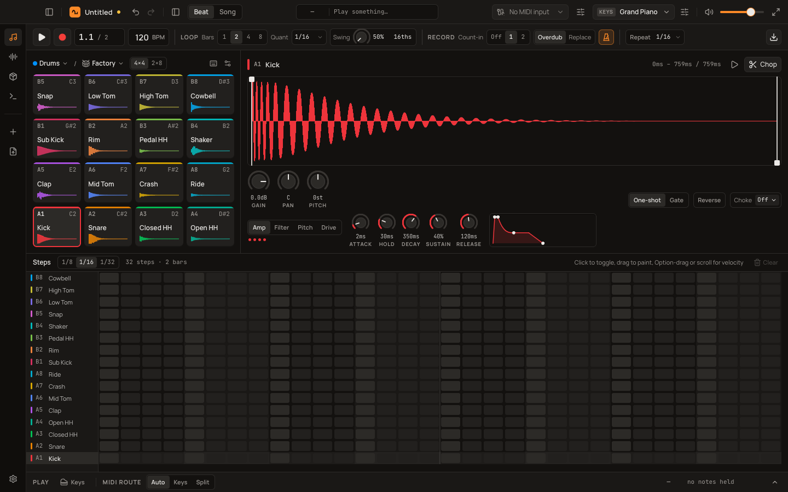

# Pad sound shaping

Rust-only feature (it has no Electron counterpart). Beat view → select a pad → the pad editor
has a second row under GAIN / PAN / PITCH with four sections: **Amp**, **Filter**, **Pitch**
and **Drive**. A dot under each tab lights when that section changes the sound.

## Controls

| Section | Control | Key (JSON) | Range | Neutral |
|---|---|---|---|---|
| Amp | Attack | `ampAttack` | 0–2 s (cubic knob) | 0 |
| Amp | Hold | `ampHold` | 0–2 s (cubic knob) | 0 |
| Amp | Decay | `ampDecay` | 5 ms–4 s (log) | 0.3 s (inert while sustain = 100 %) |
| Amp | Sustain | `ampSustain` | 0–100 % | 100 % |
| Amp | Release | `decay` (the old DECAY knob) | 5 ms–4 s (log) | 50 ms |
| Filter | LP / HP / BP | `filterType` | `lp` `hp` `bp` | `lp` |
| Filter | Cutoff | `filterCutoff` (the old FILTER knob) | 20 Hz–20 kHz (log, Open at top) | Open |
| Filter | Reso | `filterResonance` | 0–100 % (Q 1.08 → 17) | 0 |
| Filter | Env | `filterEnv` | ±6 octaves at the hit | 0 |
| Filter | Env Dec | `filterEnvDecay` | 5 ms–4 s | 0.25 s |
| Pitch | Amount | `pitchEnv` | −24…+48 semitones at the hit | 0 |
| Pitch | Time | `pitchEnvDecay` | 5 ms–2 s | 80 ms |
| Drive | Drive | `drive` | 0–100 % (0 → +30 dB into tanh) | 0 |

The old DECAY knob was already the pad's release: the tail fade of a one-shot and the fade after
note-off in Gate mode. It is now **Release** in the Amp section, and it closes the AHDS
envelope (AHDSR). The old FILTER knob is now **Cutoff** in the Filter section. Both keep their
knob keys (`knob-decay`, `knob-filter`) and JSON keys, so existing projects need no migration.

The Amp display is an editable envelope. Drag the attack peak, the end of the hold, the
decay/sustain corner (x sets decay, y sets sustain) or the release end. Each stage's width is
its knob position, so a handle moves the same way as its knob. Filter, Pitch and Drive show
their curve but cannot be edited by dragging.

## Modes

- **One-shot.** A + H + D, then sustain until the sample ends. The release fades the last
  `decay` seconds, as before. With sustain 0, the voice ends after A + H + D, which is the way
  to shorten a long sample.
- **Gate.** The voice sustains while the pad is held. On note-off it fades over Release from
  whatever level the envelope has reached (the existing `cancelAndHold` + linear ramp).

## DSP design

- **Neutral = the old path.** `PadShape::is_neutral()` holds when there is no attack, sustain is
  100 %, the filter is LP with no resonance and no envelope, there is no pitch envelope and drive
  is 0. A voice hit on a neutral pad is a classic voice: player → AutoParam gain → pad bus →
  Chromium-parity channel (amp → biquad LP → panner). Nothing in that path changed, so existing
  projects render bit-identically. The parity, golden and export tests pass unchanged, and
  `a_neutral_shape_takes_the_classic_path_bit_for_bit` checks it directly.
- **Shaped voices** (`mdaw-engine/src/sampler/shaped.rs`) latch their envelopes at the hit.
  Each sample goes through: read (pitch-bent) → drive → SVF (cutoff × 2^(env)) → × voice gain
  (velocity, fades, release) × AHDS.
  - Every decaying stage uses `(1 − x)³`. It starts steep like an exponential but lands exactly
    on its target, so each stage has an exact length and the display draws the same function
    (`mdaw-dsp/src/pad_shape.rs`).
  - **Filter:** a TPT state-variable filter (Zavalishin/Simper) whose coefficients are computed
    per sample. It is stable under fast modulation. At resonance 0 its LP has the pad biquad's Q
    (10^(0.707/20)), so LP sounds the same. BP is normalised to unity at the centre frequency.
    A voice with its own filter feeds a second per-pad *direct* bus (amp → panner) that bypasses
    the pad's biquad, so cutoff is applied once.
  - **Pitch envelope:** the voice reads its buffer itself with linear interpolation and a
    per-sample rate of `base × 2^(st/12)`. The Web Audio buffer source has a k-rate rate and
    would zipper. The voice length is integrated at the hit (`pitched_duration`, 0.5 ms steps,
    no allocation), so the one-shot release fade and the export length stay correct
    (`voice_seconds` is shared with `export/end_seconds.rs`).
  - **Drive:** `tanh(g·x)/tanh(g)`, with g from 0 to +30 dB. Peaks stay at ±1 and quiet parts
    are lifted. It cross-fades in over the first 25 % of the knob, so there is no step at 0, and
    0 is an exact bypass.
- **Smoothing.** Cutoff (in log2), Q and drive follow the pad live through per-pad one-pole
  smoothers (τ = 15 ms). They advance once per quantum and are interpolated linearly inside it.
  A smoother snaps onto its target when it is within 1e-6, so drive returns to an exact bypass.
  Envelope times, sustain and the filter type are latched per voice, so changing them never
  affects a sounding voice.
- **Realtime.** The patch is still built on the control side (`PadParams` from `PadSettings`)
  and travels in the existing `SamplerCommand::SetKit`. Shaping state is `Copy` and lives in the
  fixed voice slots and per-pad arrays. Buffers still go back through the garbage list. The
  audio thread does not allocate or lock (`shaped_voices_do_not_allocate`).
- **Limits.** A voice hit while its pad was neutral stays classic: shaping applies from the next
  hit, except drive, which applies to voices hit while drive is still fading out. The filter
  envelope is per voice. A pad's base cutoff and resonance are shared.

## Persistence

The fields are flat keys on the pad (`PadSettings.shape`, `#[serde(flatten)]`). Each has a serde
default and is omitted from the JSON while neutral, so older files load and unshaped pads
serialize exactly as before. `normalizePad` clamps them, so kits, projects, imports and
`updatePad` patches all go through the same validation. Undo/redo works through the existing
snapshots. Copy/paste writes every shaping key (`PadShape::to_full_json`), so pasting an
unshaped pad also clears the target's shaping. Kit save/load stores the pad JSON.

## Tests

- `mdaw-dsp/src/pad_shape/tests.rs`: envelope stage timing, zero sustain, the decay curve, the
  pitch-envelope duration against fine numeric integration, the SVF LP/HP/BP response, its
  resonance and its stability under modulation, drive bypass, bounds and smoothness, and the
  smoother.
- `mdaw-engine/src/sampler/shaped_tests.rs`: neutral is bit-identical; AHDS in one-shot;
  sustain 0 frees the voice; Gate sustain and release; filter types; resonance and filter
  envelope; the pitch envelope bends the hit and shortens it; drive; gliding cutoff and drive
  changes with no step; the export length; no allocation.
- `mdaw-engine/src/engine/tests_export.rs::pad_shaping_changes_the_exported_render`: a full
  offline export render where each control moves the output, and a neutral edit renders the
  same.
- `mdaw-model/src/doc/tests_beat.rs`: defaults, omission from the JSON, old pads, round-trip,
  clamping and undo/redo.
- `mdaw-app/src/tests/t_shaping.rs`: tabs, knobs (one undo step per gesture), dragging the
  envelope handles, copy/paste, and the fit at 1440×900. Snap scenes: `pad-shaping`,
  `pad-shaping-filter`, `pad-shaping-pitch` and `pad-shaping-drive` (screenshots in
  `docs/parity/pad-shaping/`).

Not verified: nobody has listened to it. The tests check levels, spectra, timing and
continuity, but whether it sounds good still has to be judged by ear.
